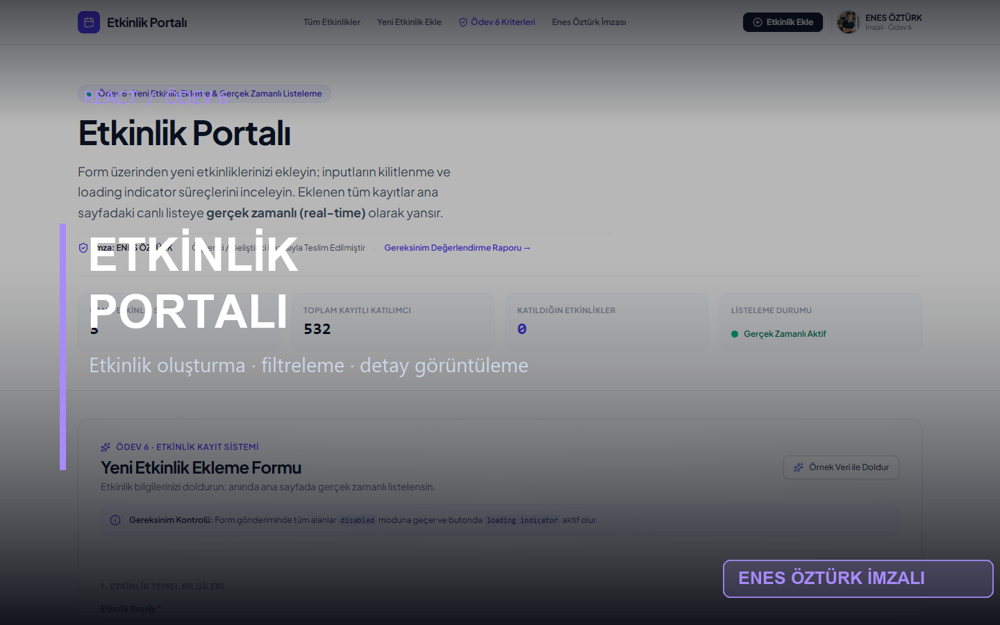
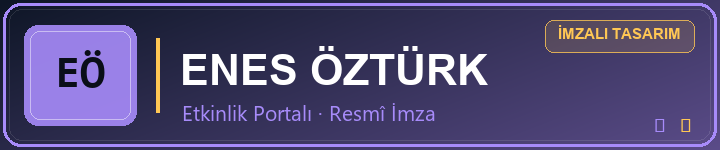
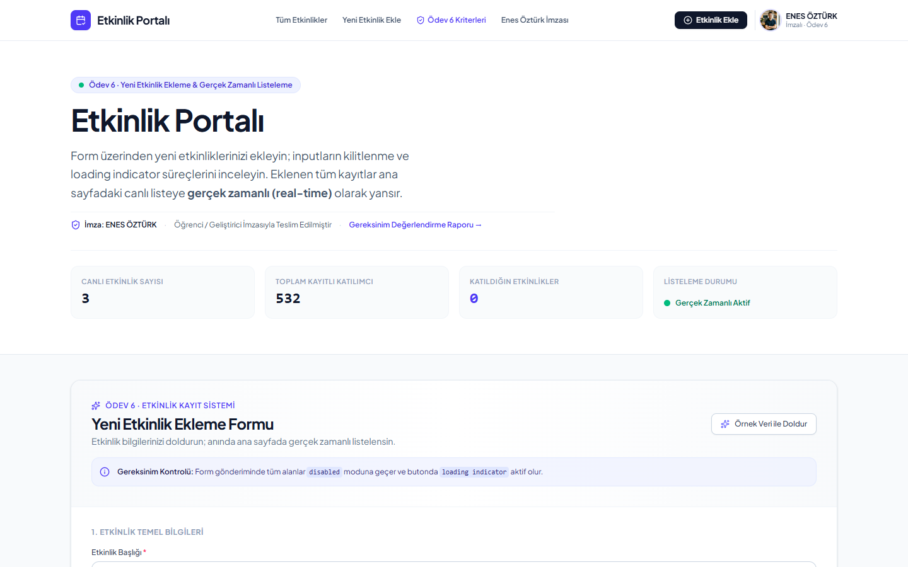
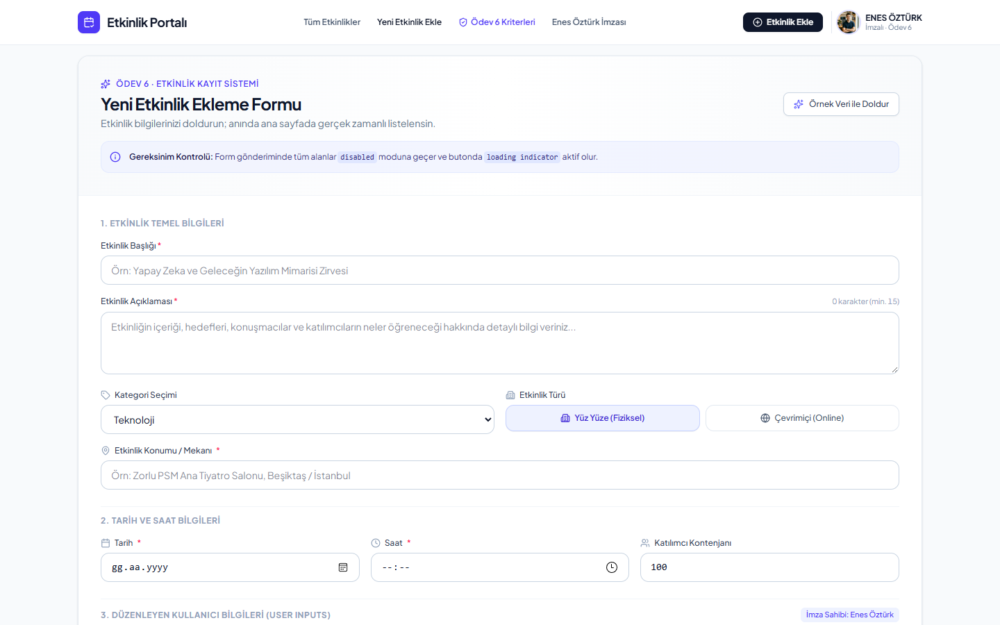
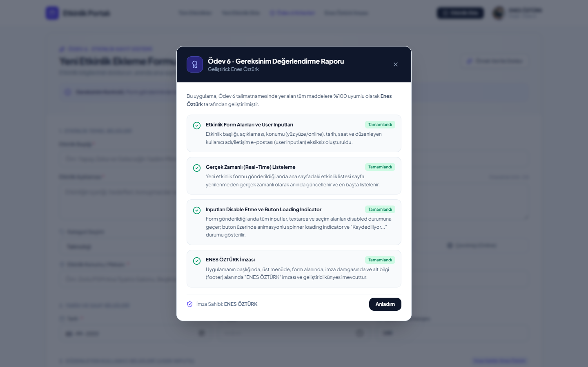

<div align="center">



# Etkinlik Portalı

**Ödev 6 — etkinlik oluşturma formu, kategori filtreleri, detay görüntüleme ve gereksinim değerlendirme raporu içeren React uygulaması.**

[](https://github.com/EnesBinMalik/etkinlik-portali)
[](https://github.com/EnesBinMalik/etkinlik-portali)
[](https://github.com/EnesBinMalik/etkinlik-portali)
[](https://github.com/EnesBinMalik/etkinlik-portali)
[](https://github.com/EnesBinMalik/etkinlik-portali)
[](https://github.com/EnesBinMalik)



</div>

---

## Hakkında

Etkinlik Portalı, Patika.dev Node.js/React patikasının 6. ödevidir. Kullanıcı yeni etkinlik oluşturabilir, mevcut etkinlikleri kategoriye göre filtreleyebilir, detaylarını inceleyebilir ve katılım durumunu yönetebilir. Arayüz, ödev kriterlerini tek ekranda denetleyen bir rapor paneli de sunar.

> Bu proje **Enes Öztürk** tarafından tasarlanmış, geliştirilmiş ve imzalanmıştır.

---

## Öne çıkan özellikler

| Özellik | Açıklama |
| --- | --- |
| **Yeni Etkinlik Ekle** | Başlık, tarih, konum, kategori ve açıklama alanlı form. |
| **Kategori filtreleri** | Teknoloji, Tasarım & Sanat, Eğitim & Kariyer, Girişimcilik. |
| **Etkinlik kartları** | Yüz yüze / çevrimiçi rozetleri, tarih ve konum bilgisi. |
| **Detay modalı** | Etkinliğin tüm alanlarını tek pencerede gösterir. |
| **Ödev 6 raporu** | Gereksinimlerin karşılanma durumunu denetler. |
| **Örnek veri** | Tek tıkla demo etkinlikleri yükler. |

---

## Kapsam

| Ölçü | Değer |
| --- | --- |
| Ödev | 6 |
| Kategori | 4 |
| Form alanı | 6 |
| Rapor | Anlık |

---

## Galeri







---

## Kurulum

**Gereksinim:** Node.js 20+

```bash
git clone https://github.com/EnesBinMalik/etkinlik-portali.git
cd etkinlik-portali
npm install
npm run dev
```

> Uygulama tamamen istemci tarafında çalışır; API anahtarı gerektirmez.

Diğer komutlar:

```bash
npm run build     # Üretim derlemesi
npm run preview   # Derlemeyi önizle
npm run lint      # TypeScript tip kontrolü
```

---

## Teknik mimari

```text
src/components/AddEventForm.tsx   Etkinlik oluşturma
src/components/EventCard.tsx      Kart görünümü
src/components/EventDetailModal.tsx  Detay penceresi
src/components/RubricModal.tsx    Ödev kriterleri
src/data/initialEvents.ts         Örnek veri
src/types/event.ts                Tip tanımları
```

---

## İmza

<div align="center">

[](https://github.com/EnesBinMalik)
[](https://github.com/EnesBinMalik)

**Bu kod, tasarım ve deneyim Enes Öztürk'ün kişisel imzasını taşır.**

© 2026 Enes Öztürk — Tüm hakları saklıdır.

</div>
